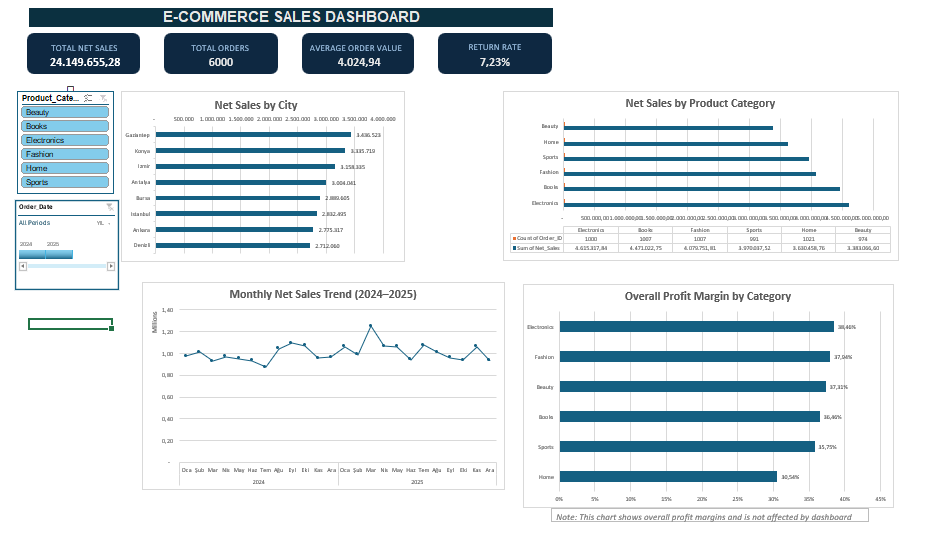

# E-Commerce Sales Analytics Dashboard

## Project Overview

This project analyzes a synthetic e-commerce dataset containing **6,000 orders from 2024–2025**.

The goal is to evaluate sales performance, order trends, product profitability, and return rates using Microsoft Excel.

## Tools & Technologies

- Microsoft Excel
- Power Query
- PivotTables & PivotCharts
- Excel formulas (SUMIFS, COUNTIFS, GETPIVOTDATA)
- Interactive dashboards, slicers, and timelines

## Dashboard Preview

## Key Features

- Interactive sales dashboard with dynamic KPI cards
- Sales analysis by city, product category, and month
- Product profitability and profit margin analysis
- Order and return rate monitoring
- Dynamic filtering by product category and date

## Key Findings

- **Total Net Sales:** 24.15 million
- **Total Orders:** 6,000
- **Overall Return Rate:** 7.23%
- **Highest Profit Margin:** Electronics (38.46%)
- **Lowest Profit Margin:** Home (30.54%)

## Business Recommendations

- Investigate opportunities to improve profitability in the Home category.
- Develop targeted promotional campaigns and cross-selling strategies.
- Monitor sales and return trends to identify potential operational improvements.

## Dataset

This project uses synthetic training data. It does not contain actual customer or company records.

## Project Files

- `E-Commerce_Sales_Analytics_Dashboard.xlsx` — Interactive Excel dashboard and analysis
- `dashboard.png` — Dashboard preview
